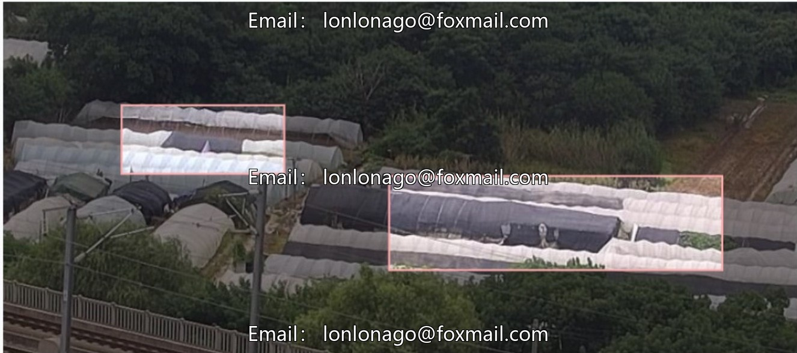
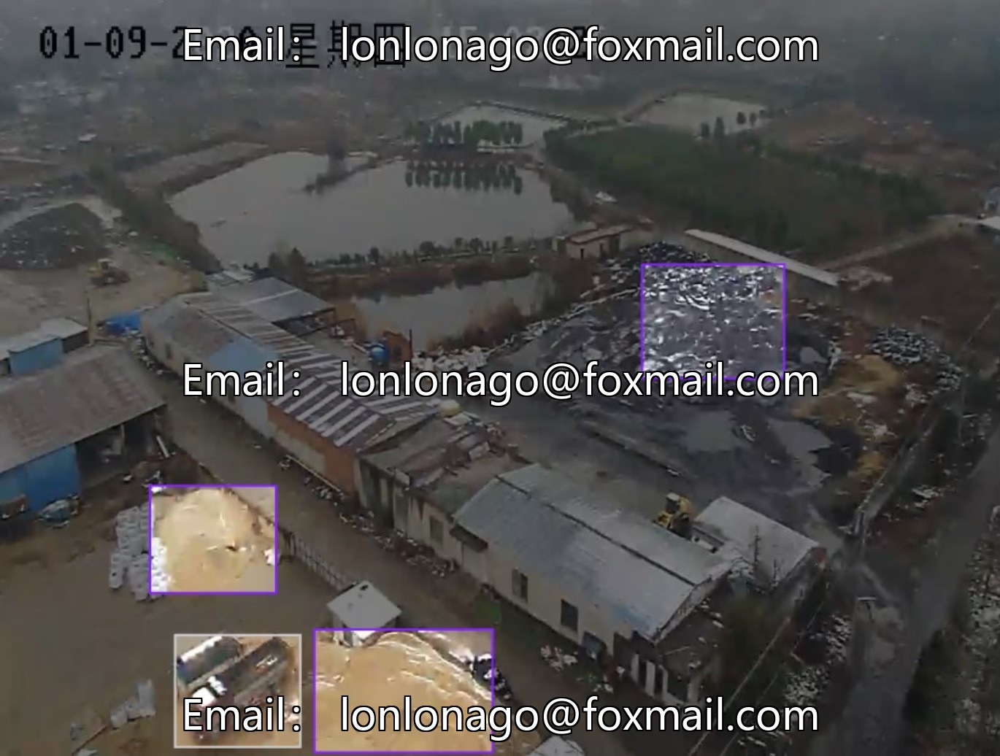
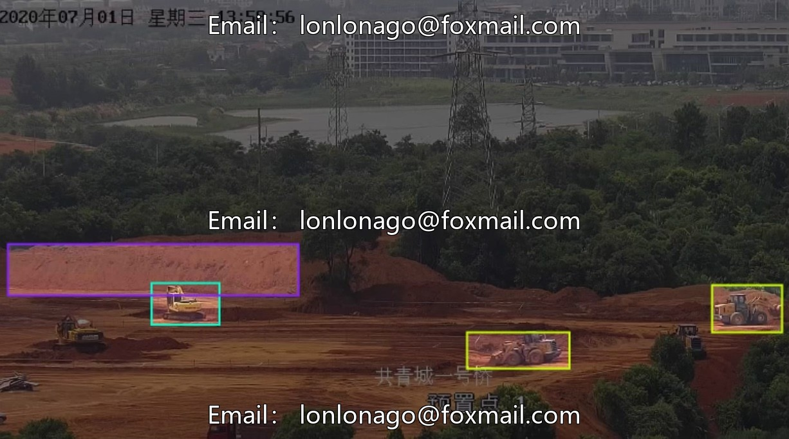
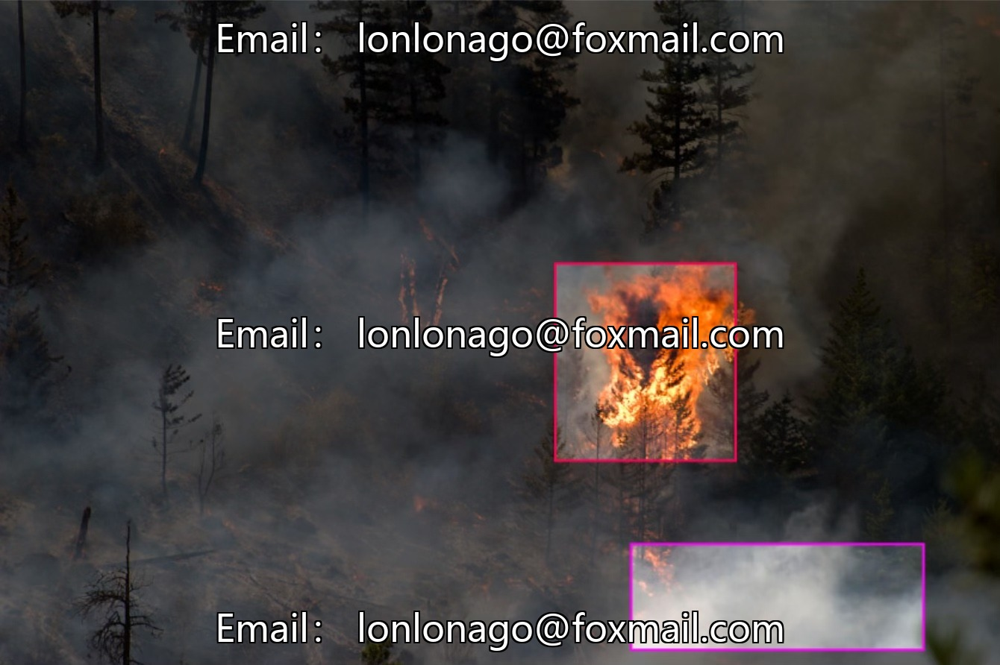
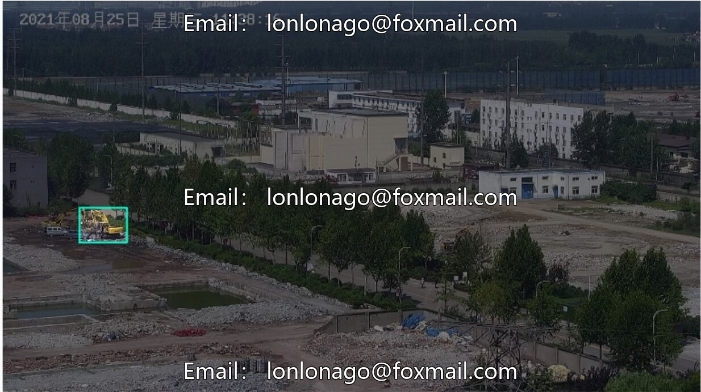
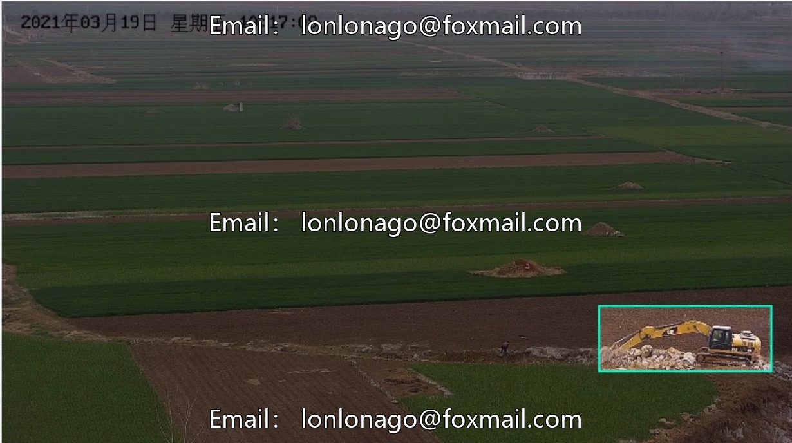
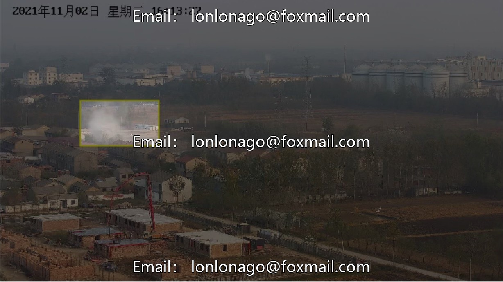

# UAV Smart Construction Site Aerial Inspection Data Set

## Body

UAV Smart Construction Site Aerial Inspection Data Set
Includes recognition of 12 categories such as drone smoke, open flames, greenhouses, color steel tile houses, green buildings, mixers, pit lake water surface, tower cranes, soil piles, bulldozers, excavators, dump trucks, etc. Suitable for intelligent supervision of construction sites, compliance with equipment operations, and warning in hazardous areas.

The dataset contains 3199 labeled images, covering key objects such as construction equipment, site environment, and special facilities. It is compatible with mainstream computer vision training frameworks and can export multiple standard annotation formats. It supports model training and automated recognition.

Virtual materials, once sold, are non-refundable.
Interested friends, click "I want" to proceed.

## Images

## Payment

Here is a pay link on Stripe ( https://buy.stripe.com/3cs8yP7sY87d0vu9AB ). Please contact me lonlonago@foxmail.com after funding $89, and I will send you a complete data files , thank you!

